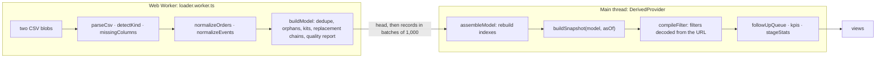

# Development guide

This guide covers the day-to-day engineering work on the Kit Ops dashboard: setting up the project, understanding how it is put together, running the tests, checking performance and deploying a release.

For an explanation of the dashboard itself and the reasoning behind its data rules, see [README.md](README.md).

**Live app:** https://jeffmilamba-co.github.io/nebula-kit-dashboard/

## Getting started

The project requires **Node 24.x** (the version is pinned in `engines`) and npm. You will also need **Google Chrome** to run the end-to-end suite. Playwright uses the Chrome installation already on your machine, so it does not need to download another browser.

From the project root, run:

```sh
npm ci
npm run dev          # Starts the app at http://localhost:5173 and loads the sample CSVs from public/data/
npm run check        # Runs linting, typechecking and unit tests — the same checks used by CI
npm run test:e2e     # Builds the app, serves it on :4175 and runs Playwright on desktop and phone
```

### Available scripts

| Script | Purpose |
| --- | --- |
| `dev` / `build` / `preview` | Start the Vite development server / typecheck and build the production app into `dist/` / serve the contents of `dist/` |
| `test`, `test:watch` | Run the Vitest unit tests in Node. They use a non-UTC timezone; see [Testing](#testing). |
| `test:e2e` | Run the Playwright suite. Set `E2E_BASE_URL` to point the tests at a deployed instance. |
| `lint` | Run oxlint. |
| `typecheck` | Run `tsc -b` across the app, test, e2e and Node projects. |
| `bench` | Measure each data-pipeline stage using the sample data scaled by the supplied factor. For example: `npm run bench -- 1 10 50`. |

## Architecture

Kit Ops is a static single-page application built with React 19, Vite 8, Tailwind 4 and TypeScript 7. It has no backend. CSV files are parsed in the browser, and uploaded data never leaves the user's device.

The code is split into a few clear layers:

| Layer | Responsibility |
| --- | --- |
| `src/data/` | The domain layer: CSV ingestion, normalization, the data model, the kit state machine, duration calculations, statistics and filters. It is deliberately framework-free and pure. It accepts strings and returns plain objects, which lets the same logic run in the Web Worker, Vitest, `scripts/bench.ts` and the end-to-end test oracle. |
| `src/app/` | Application wiring: loading data (worker and streaming), hash-based routing, derived state, lazy-loaded pages and the error boundary. |
| `src/views/` | Page-level components: Overview, Turnaround, Follow-up, Orders (including order detail) and Data. |
| `src/layout/`, `src/ui/` | The application frame — navigation, filter bar and rail cards — plus reusable presentation components such as cards, badges and the CSS stacked-column chart. |
| `src/lib/` | Shared helpers for formatting, colours and CSV downloads. All displayed dates use UTC formatting. |

### Data flow

The initial CSV processing happens in a Web Worker. Once the model has been assembled, the main thread derives the current snapshot and the data needed by the views.



The points at which the app recalculates data are intentional:

- **When a dataset loads:** the worker parses the files, normalizes the rows and builds the model.
- **When the as-of date changes:** `buildSnapshot` recalculates each order's stage, elapsed time and health for that point in time.
- **When a filter changes:** only the filter, follow-up queue and aggregates are recalculated. Filters are memoized using a canonical `filterKey`, so changes to search terms or pagination do not invalidate them. `useDeferredValue` keeps typing responsive while this work runs.

### Loading a dataset

The loading flow is implemented in `src/app/loader.ts` and `src/app/DataProvider.tsx`.

- CSV parsing and model construction run in a **module Web Worker**. The worker sends a small model "head" first, followed by records in **batches of 1,000**. Structured-clone deserialization runs on the main thread once per message. Batching keeps each task to roughly 10 ms, rather than creating a single blocking task of about 0.5 seconds with 50k orders.
- **The most recently started load takes precedence.** Each load has its own `AbortController`. Starting another load aborts the previous one, terminates its worker and releases the worker's memory.
- **A failed upload does not replace the current dataset.** The existing data remains available, and the user sees the messages from `LoadError.messages`. A failed sample-data load is fatal only when there is no dataset loaded yet.
- If Web Workers are unavailable, or the worker script fails before it sends a message, the same processing pipeline runs on the main thread. The parser is downloaded only when this fallback is needed.
- The new model is committed inside `startTransition`, allowing React to render the views in smaller chunks.
- The sample files are fetched when the app mounts rather than through `<link rel=preload>`. In Chrome, taking over a preload that was still downloading the 1.8 MB events file intermittently produced a "Failed to fetch" error.

The app identifies uploaded files from their headers, not from the order in which they are selected. Header matching normalizes byte-order marks, case, spaces and hyphens. Extra columns are ignored, and Papa Parse handles quoting and delimiter detection.

The required columns are:

| File | Required columns |
| --- | --- |
| orders | `order_id`, `created_at`, `product`, `status` |
| kit events | `order_id`, `kit_id`, `event_type`, `occurred_at` |

### State in the URL

`src/app/router.ts` contains a small hash router, roughly 60 lines long, built on `useSyncExternalStore`.

The URL hash stores both the current route and the state of the view: filters (`from`, `to`, `product`, `country`, `status`, `test`), the `asof` date, search terms and pagination. Keeping that state in the URL has a few practical benefits:

- Every view can be shared as a deep link, including a filtered follow-up queue or an individual order.
- GitHub Pages can serve the app without SPA rewrite rules.
- Filter changes use `replaceState`. As a result, the browser's Back button moves between pages instead of stepping through every filter adjustment.
- `encodeFilters` leaves default values out of the URL. When the URL is decoded, values that do not exist in the loaded dataset are discarded.

The uploaded dataset is not persisted. Reloading the page, or opening a shared link in another browser, loads the bundled sample data instead.

### Code splitting and error handling

- Each page is built as a separate chunk in `src/app/pages.tsx`. `main.tsx` starts downloading the current route's chunk alongside the data; the remaining pages are prefetched through `requestIdleCallback`. React and React DOM are kept in a separate, long-cached chunk in `vite.config.ts`.
- `lazyPage()` is used instead of `React.lazy`. After a page chunk has loaded, it can render synchronously. `React.lazy` suspends on the first render, which can delay the reveal by up to roughly 300 ms.
- `PageErrorBoundary` isolates a page-level crash. Navigation, filters and the loaded dataset remain available. The boundary resets when the route changes. It also detects when a chunk referenced by the current page no longer exists after a deployment and offers a reload rather than showing a stack trace.

## Domain model: where the rules live

The README explains why the dashboard uses these rules. The in-app **Data** page shows each rule alongside the number of rows it affected in the uploaded files.

Use this table to find the implementation:

| Concern | Rule | Code |
| --- | --- | --- |
| Timestamps | Use an explicit parser, never `Date.parse`. Values without a timezone are read as UTC, offsets are converted, and impossible dates are rejected. | `data/time.ts` |
| "Now" | Use the latest timestamp in the files. It can be overridden with `?asof=YYYY-MM-DD`. | `model.ts` (`maxTimestamp`), `app/derived.tsx` |
| Duplicate events | Merge rows with the same order, kit, event type and instant. Prefer the row with an explicit timezone over a zone-less row. | `model.ts` `mergeDuplicates` |
| Orphan events | Events whose `order_id` is missing from the orders file are excluded from metrics and listed on the Data page. | `model.ts` |
| Kit identity | Identify a kit by `order_id\|kit_id`. Reusing a kit ID on another order creates a separate kit. | `model.ts` |
| Kit state | Keep the furthest milestone reached rather than the latest timestamp. For QC, use the latest result. | `state.ts` `kitStateAt` |
| Order stage | Use the latest-started kit that has not been replaced. | `state.ts` `snapshotOrder` |
| Durations | Calculate each kit's duration from its first scan to the next first scan. Do not calculate across a missing scan; discard and count negative intervals. | `durations.ts` |
| Health | Overdue means age is greater than the target; at risk means age is at least 80% of the target. Non-paid orders are `closed`. | `state.ts`, `config.ts` |
| SLA % | Within target ÷ (completed + currently overdue). | `stats.ts` |
| Follow-up | Include paid orders only. Rank them by age ÷ target, then map each to an owner and an action. | `followup.ts`, `config.ts` |
| Default view | Show paid orders and hide test orders. The UI reports what the filters exclude. | `filters.ts`, `metrics.ts` `exclusions` |

`src/data/config.ts` is the single source for stage labels, targets, owners and follow-up actions. Updating a target or owner there carries through to every view, the tests and the CSV export.

## Testing

Run the complete unit suite or target a specific test with the following commands:

```sh
npm test                                      # all unit tests
npx vitest run src/data/__tests__/model.test.ts
npx playwright test --project=desktop -g "Requirement 3"
E2E_BASE_URL=https://jeffmilamba-co.github.io/nebula-kit-dashboard/ npx playwright test
```

### Unit tests

The Vitest suite contains **74 tests across 8 files**. It exercises the data layer and CSV export. Tests run with `TZ=America/Los_Angeles`, which means code that accidentally parses timestamps in the machine's local timezone will fail. One test also checks that the timezone is set as expected.

Coverage includes:

- `time`: timestamp formats, leap years and a day-by-day comparison against `Date` across multiple decades.
- `ingest`: malformed or inconsistent input, including BOM, CRLF, header case, semicolons and quoted commas; file detection and error messages.
- `model`: deduplication, orphan events, replacement chains, every kit state, the as-of cutoff, and overdue and at-risk boundaries.
- `stats`: R-7 quantiles and the SLA denominator.
- `filters`: URL round-tripping and filtering by product, country and date.
- `stream`: rebuilding the model from cloned batches and checking that `buildModel` does not mutate its input.
- `golden`: headline figures for the bundled sample, calculated independently before the app was built. **A failing golden test means a data rule has changed.** Update its expected values deliberately and explain the reason in the commit.

### End-to-end tests

The Playwright tests are in `e2e/`. There is a separate `describe` block for each requirement in the brief, along with coverage for navigation and file uploads.

- Expected values are produced by running the data layer in Node against the same CSV files. This lets the tests verify that the UI displays the results computed by the unit-tested logic. Filter counts are also checked against an independent count from the raw CSV.
- Any browser console error or uncaught exception fails the suite.
- The `desktop` project uses a 1280×900 viewport. The `mobile` project uses a 390×844 touch viewport and runs tests tagged `@mobile` and `@a11y`.
- axe-core scans every page and an order-detail view against WCAG 2.1 A/AA on both viewports.
- Upload tests use a deliberately messy fixture. They also cover invalid uploads and restoring the bundled sample.

## Performance

The following measurements come from `npm run bench` on Node 24.22, using a development laptop. Each figure is the median of three runs.

| Stage | 5k orders / 24k events | 50k orders / 242k events |
| --- | ---: | ---: |
| Parse CSV | 46 ms | 406 ms |
| Normalize | 34 ms | 323 ms |
| Build model | 37 ms | 476 ms |
| **Load total (in the worker)** | **116 ms** | **1,206 ms** |
| Snapshot (per as-of change) | 16 ms | 57 ms |
| Recompute (per filter change) | 10 ms | 39 ms |

Browser measurements from the performance work in commit `19a4626` show the impact of the changes:

- **50k-order upload:** the longest main-thread task dropped from 1,509 ms to 66 ms. Page heap usage fell from 278 MB to 150 MB.
- **Cold load with a 4× CPU throttle:** total blocking time fell from 1,281 ms to 86 ms.
- **Landing-page JavaScript:** the gzipped bundle went from 212 KB to 93 KB after Recharts was replaced with a CSS chart.

Load time increases roughly linearly with input size, and the complete model remains in browser memory. For datasets substantially larger than about 50k orders, the next step would be to move model processing to a server.

## CI/CD and deployment

`.github/workflows/deploy.yml` runs on every push to `main` and can also be started manually.

The workflow has three jobs:

1. **Build:** runs `npm ci`, linting and unit tests, then `npm run build` (which includes `tsc -b`) with `VITE_BASE=/<repo>/`. The resulting `dist/` directory is uploaded as the GitHub Pages artifact.
2. **End-to-end tests:** runs alongside the build. The full Playwright suite uses the Chrome installation available on the runner and tests a locally built copy of the app.
3. **Deploy:** runs only after both the build and end-to-end jobs pass, then publishes the artifact to GitHub Pages.

Deployments are serialized with `concurrency: pages`. If a newer push arrives while a deployment is still running, the older deployment is cancelled.

## Conventions

- **TypeScript 7, strict mode.** The project uses `erasableSyntaxOnly` and `.ts` extensions in imports. This allows Node to run `scripts/bench.ts` and the data layer directly, without a separate build step.
- **oxlint instead of typescript-eslint.** The latter does not yet support TypeScript 7. Configuration lives in `.oxlintrc.json`; `import/no-cycle` and `react/exhaustive-deps` are treated as errors. `src/data` sorts arrays in place intentionally: copying hundreds of thousands of elements during loading would add cost without a meaningful benefit.
- **Parse CSV timestamps only with `parseTimestamp`.** Do not call `Date.parse` or `new Date(string)` on values from a CSV. Display dates through `src/lib/format.ts` in UTC, or use `fmtLocal` when the customer's own offset is required.
- **Route every CSV export through `toCsv`.** It neutralizes spreadsheet formulas (`=`, `+`, `-`, `@`, tab and CR) in cells originating from uploaded files.
- **Adding a page requires five edits:** update both `pages` and `BY_SECTION` in `pages.tsx`, the `Routes` switch in `App.tsx`, `TopNav`, and the `PAGES` list in `e2e/a11y.spec.ts`.

## Project layout

```text
public/data/          sample orders.csv + kit_events.csv (served as-is)
scripts/bench.ts      data-pipeline benchmark
src/
  data/               domain logic, framework-free (+ __tests__/)
  app/                loading, routing, derived state, lazy pages, error boundary
  views/              one file per page
  layout/  ui/  lib/  frame, primitives, helpers
e2e/                  Playwright specs + shared helpers / oracle
.github/workflows/    test-and-deploy pipeline
```
